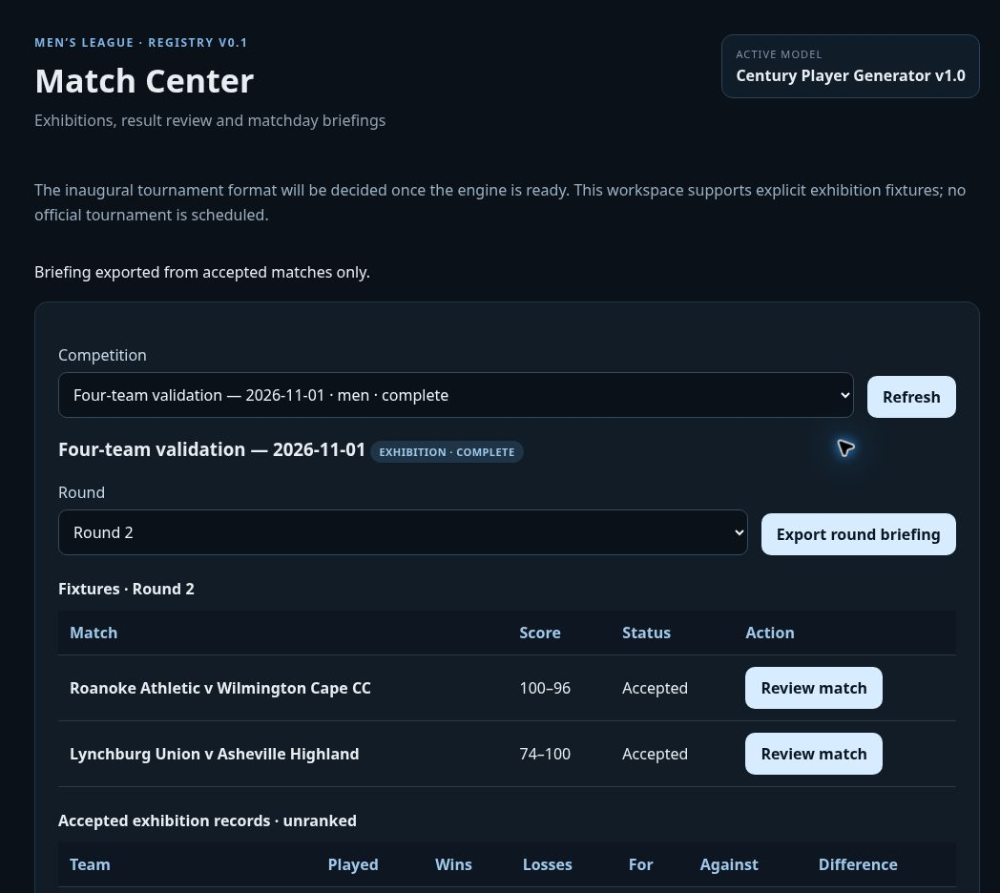

# Four-team, two-round live validation

The published Match Center completed a separate exhibition using imported season rosters and original coaching preferences. Competition `c37ed747-7edf-4197-b51d-2628ce9f4baa` finished at revision **5**, with **four accepted results and four acceptance audit events**. Each match has 70 player box scores. The database still has 18 season roster snapshots and zero official competitive competitions. The inaugural tournament format remains deferred.

## Match summaries

| Round | Match | Playing minutes | Lead changes | Winning central kick |
| --- | --- | ---: | ---: | --- |
| 1 | Roanoke Athletic **100–88** Lynchburg Union | 106.1 | 0 | Ruben Lane, event 4868; four points |
| 1 | Wilmington Cape CC **75–100** Asheville Highland | 64.7 | 0 | Paul West, event 3165; two credited points after the cap |
| 2 | Roanoke Athletic **100–96** Wilmington Cape CC | 83.9 | 11 | Felipe Smith, event 3910; one credited point after the cap |
| 2 | Lynchburg Union **74–100** Asheville Highland | 68.0 | 2 | Paul West, event 3154; one credited point after the cap |

Roanoke opened with a 28–4 quarter against Lynchburg and stayed in front. Lynchburg reduced the final margin to 12 after trailing by as many as 27. Felipe Smith scored 21 points for Roanoke, while Ryan Campos contributed 17 for Lynchburg. Ruben Lane supplied the final central kick.

Asheville led Wilmington 50–27 at the second break. Wilmington scored 40 points in the third quarter, but Asheville finished 100–75. Jesse Perry led the scoring with 22 points; Edgar Fernandez scored 15 for Wilmington. Paul West's nominal four-point central kick took Asheville from 98 to the capped winning score of 100.

Roanoke's second match provided the close finish: Wilmington led 51–31 at the second break, before Roanoke scored 46 points in the third quarter to lead 77–73. The game recorded 11 lead changes. Theodore Leonard led all scorers with 16 for Wilmington; Brian Patel scored 14 for Roanoke. Felipe Smith's final central kick took Roanoke from 99 to 100.

Asheville and Lynchburg were separated by two points at the first break, 26–24. Asheville then outscored Lynchburg 50–20 across the next two quarters to lead 76–44. Lynchburg won the last quarter 30–24, leaving Asheville a 100–74 winner. Joaquin Montgomery scored 17 and Keegan Fleming 16 for Asheville; Paul West delivered the final central kick.

Every winning kick was `central_air` with four nominal points; credited totals obey the maximum score of 100. Full quarter scores, team statistics, top scorers, event references and briefing facts are preserved in the [verification record](verification/four-team-validation-2026-11-01.json). This four-match workflow rehearsal is too small to reassess league balance or duration calibration.

## Cumulative records

| Team | Played | Wins | Losses | For | Against | Difference |
| --- | ---: | ---: | ---: | ---: | ---: | ---: |
| Asheville Highland | 2 | 2 | 0 | 200 | 149 | +51 |
| Lynchburg Union | 2 | 0 | 2 | 162 | 200 | −38 |
| Roanoke Athletic | 2 | 2 | 0 | 200 | 184 | +16 |
| Wilmington Cape CC | 2 | 0 | 2 | 171 | 200 | −29 |

The exhibition is unranked. Four wins and four losses reconcile, and both total points for and total points against equal 733.

## Workflow evidence

- The initial saved proposal left all four clubs at zero matches played.
- A partial Round 1 export contained exactly one accepted match and one pending fixture. The completed round export contained two accepted matches and no pending fixtures.
- After Round 1 every club had one match played, and the competition remained active. After three acceptances it remained active; completion followed the fourth acceptance.
- Reloading the browser during Round 2 recovered the same proposed Roanoke–Wilmington match, proposal ID and payload digest. The before/after exports matched exactly; recovery did not simulate another game.
- Both final round exports contain two accepted matches, no pending fixtures, recorded winning plays and summary evidence. Fatigue and injuries reset between these exhibitions.
- The deployed backend replay control passed the final match with the explicit `century-replay-coordinate-v1` policy and reported an **exact** event/statistic replay in that runtime. Offline Node replay of the recovered Roanoke–Wilmington export passed with 66 allowed lateral coordinate differences, at most four binary64 steps and 1.4210854715202004e-14 metres. All other fields matched exactly.
- The original live Roanoke–Lynchburg ledger also passes the bounded coordinate policy. Original ledgers and database digests remain unchanged. See [the versioned comparison contract](REPLAY_PORTABILITY_V1.md).

## Automated validation and publication

[PR #3](https://github.com/Golfhaus/CenturyLeague/pull/3) merged the replay comparator, honest UI reporting, offline verifier and expanded actual-service/database rehearsal. CI [run 41367966532](https://github.com/Golfhaus/CenturyLeague/actions/runs/41367966532) and post-merge [run 41368104951](https://github.com/Golfhaus/CenturyLeague/actions/runs/41368104951) passed. Checks include:

- 549 match checks and the unchanged frozen gameplay source/default fingerprint.
- 85 competition checks.
- 110 actual-service/PostgreSQL checks, including independent-session concurrency; the local PostgreSQL/WASM fallback passes 103 checks.
- 26 replay checks, including independent Node 22 and Deno 2.6.4 runs in CI; local Node 24 also passes.
- Existing roster import, player generation/lifecycle, Edge mirror, typecheck and production build checks.

Frontend [deployment 41368105026](https://github.com/Golfhaus/CenturyLeague/actions/runs/41368105026) succeeded. Supabase `manage-matches` version 2 is active with JWT verification enabled, and the updated live replay message was checked after reloading the deployed frontend. No schema or authorization policy changed.

## Remaining 1.0 work

Implement and validate the approved competitive injury/calendar recovery, suspension carryover/service and commissioner correction policies, including durable technical-attempt history. Quantitative injury recovery distributions and the discipline tariff still need calibrated implementation. Reopening closed competitions and flagging later affected matches need explicit audited behavior. These remain blockers for official activation; the match gameplay baseline remains frozen.
