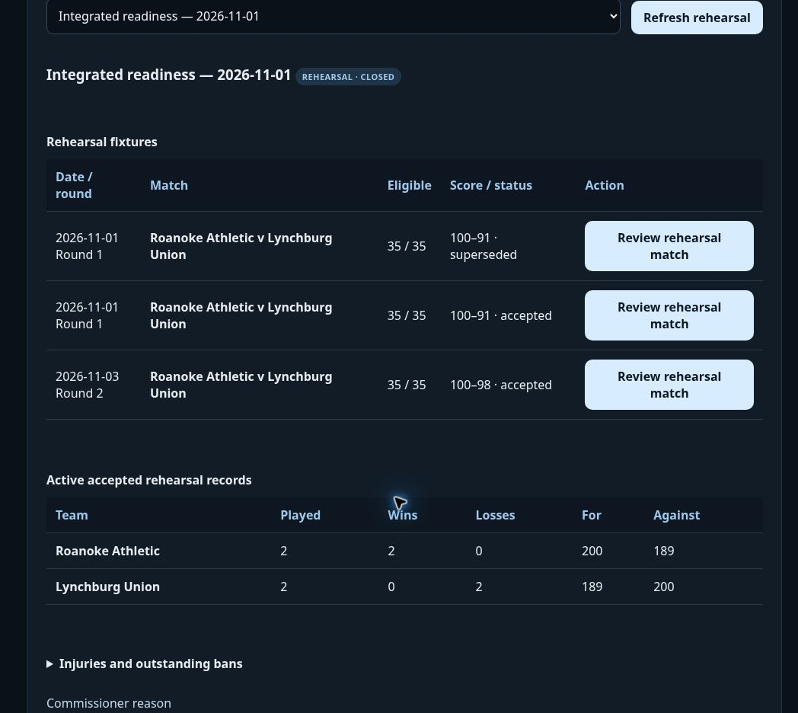

# Live competitive rehearsal verification

The published commissioner workflow completed **Integrated readiness — 2026-11-01**, rehearsal `a1b9ef69-87e4-42e3-96e1-e95bf0e2fa3b`, using canonical Roanoke Athletic and Lynchburg Union season rosters. It is closed at revision **7**. Three immutable registrations preserve the original, later match and replacement; only **two active results** contribute to records.

| Fixture | Active result | Playing minutes | Winning central kick |
| --- | --- | ---: | --- |
| November 1 · Round 1 replacement | Roanoke Athletic **100–91** Lynchburg Union | 105.7 | Spencer Walsh, event 4796; three credited points after the cap |
| November 3 · Round 2 | Roanoke Athletic **100–98** Lynchburg Union | 98.5 | Ravi Everett, event 4478; four points |

Round 1 recorded five lead changes and a largest lead of 13. Nico Flores led all scorers with 21 points for Roanoke. The final nominal four-point central kick was capped at 100, with three points credited. Round 2 had Lynchburg ahead 53–33 at the second break; Roanoke won the last quarter 32–22 to finish 100–98. Ruben Edwards led all scorers with 17 for Lynchburg. Both exports retain quarter scores, team statistics, all 70 player totals and cited winning-play facts.

| Team | Played | Wins | Losses | For | Against |
| --- | ---: | ---: | ---: | ---: | ---: |
| Roanoke Athletic | 2 | 2 | 0 | 200 | 189 |
| Lynchburg Union | 2 | 0 | 2 | 189 | 200 |

## Observed live behavior

- The fixture planner saved the explicit November 1 and November 3 dates. Live QA exposed a native date-input synchronization issue; it was fixed and verified before any rehearsal fixture was saved.
- Initial proposals left both teams at zero played. After accepting Round 1, the proposed Round 2 score did not add another played match or update cumulative points.
- Acceptance saved each result and its availability effects through the deployed backend. Inputs were pinned before simulation, including all 35 canonical players per side, date, seed, engine source and eligibility.
- Round 2 supplied a serious-foul review for Ryan Campos at event 1866. A clearly labeled **rehearsal-only** one-match commissioner sanction exercised the manual decision path; this was not adoption of an automatic league tariff. The ban remained outstanding after the historical replacement, whose November 1 eligibility correctly excluded the later November 3 decision.
- An explicit administrative **validation test correction** voided the Round 1 registration. Its contribution disappeared from active records, leaving only Round 2 counted, and Round 2 was flagged for review. Its result was not automatically replayed or voided.
- The original Round 1 JSON payload and digest were unchanged between the accepted and voided-source exports. Its SHA256 remains `30d125c50acb55ae14022d6f996c4f98326ecbcf1304534f54b656e7eb9804ec`.
- A distinct replacement fixture retained the original source seed and canonical teams, reconstructed historical availability, and reproduced the 100–91 result. Accepting it restored two active results without counting the voided original. The affected Round 2 result was then explicitly reviewed and upheld.
- Closure followed completion of both current fixtures and all required reviews. After a full browser reload, the closed state and cumulative records recovered correctly. The correction control was disabled until explicit reopening. The deployed replacement replay passed **exactly**.
- Final round exports contain one active accepted match each, no pending fixtures, no unresolved review flag and 70 player-total rows. The voided source is omitted. Points reconcile to 389 across both active games.
- This live sample produced **no injuries**. Calendar recovery, injured-player exclusion, carryover and injury-related abort behavior are covered by the deterministic automated suites; the live evidence does not claim an observed injury case.

Machine-readable briefings, source references, database registration/event evidence and final checks are in the [verification record](verification/integrated-rehearsal-2026-11-01.json). Raw full-roster proposal exports remain outside the repository evidence bundle.

## Publication and automated checks

[PR #5](https://github.com/Golfhaus/CenturyLeague/pull/5) merged as `835e7e5835f912dbec99595b5d5aa526bb179e12`. The native date-input fix is `d1f1f8a5da31ce1176b3f65747761d20523f8ac8`. CI [41379259044](https://github.com/Golfhaus/CenturyLeague/actions/runs/41379259044) and date-fix CI [41379818385](https://github.com/Golfhaus/CenturyLeague/actions/runs/41379818385) passed, including:

- **59 integrated service/PostgreSQL checks**, including independent writers, injected registration failure with complete rollback, and lost-successful-reply recovery.
- **67 competitive domain checks**, including independent Node/Deno replay, historical eligibility, changed-pairing review propagation and unchanged healthy-match behavior.
- **47 operations storage checks**, **110 exhibition database checks**, **549 match checks**, **85 competition checks** and **26 replay checks**.
- Existing roster, generation/lifecycle, source mirror and production build checks. Application and deployed Edge source also pass their type checks.

Both migrations are deployed, and `manage-matches` version **3** is active with JWT verification enabled. Frontend [deployment 41379818378](https://github.com/Golfhaus/CenturyLeague/actions/runs/41379818378) succeeded. The adapter source fingerprint is `c221b03cd89fb52ea13294a6686e47f9ded99a08f77b0c520fe5498657f58bc5`; the frozen exhibition source/default fingerprint remains `9513ba17bef8814027cc3408731f7d26db9c8ce8cd5a25f52c42175286db3521`.

## Isolation and remaining release gates

Final database checks show **zero official competitive competitions**, the same **five existing exhibition results**, **18** season roster snapshots and **630** rostered players. Nine new private tables have RLS enabled and no browser table grants. Backend-only RPCs require fresh commissioner authorization. The RLS-without-policy informational notices are intentional deny-by-default behavior for these private tables; the pre-existing [password protection warning](https://supabase.com/docs/guides/auth/password-security#password-strength-and-leaked-password-protection) remains unchanged.

The transaction and commissioner surface are now verified for protected rehearsals. Workflow 1.0 and official activation are still gated on numeric-policy adoption/calibration and a category-wide official availability/registration binding that spans competitions, transfers and monthly seasons. Automatic bans additionally require an approved named-offense tariff. The inaugural tournament format remains deferred as requested.
