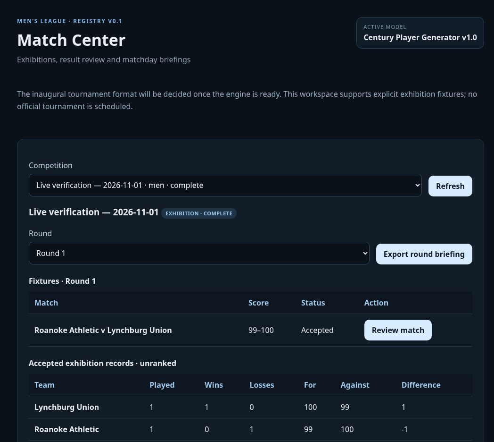

# Live exhibition verification — November 1, 2026

The signed-in commissioner completed the published workflow in the shared browser at `https://golfhaus.github.io/CenturyLeague/#`. This was one deliberately separate exhibition, named **Live verification — 2026-11-01**, with explicit Round 1 pairings and the imported canonical season rosters. It did not set the inaugural tournament format or activate official competition.

**Lynchburg Union defeated Roanoke Athletic 100–99.** Kiran Miranda supplied the winning central air kick, credited with four points, at event 5389. The game recorded 118.7 playing minutes, 12 lead changes and a largest lead of 17. Nico Flores led all scorers with 19 points for Roanoke. The full ledger contains 5,391 events and 70 player box scores.

| Quarter | Roanoke points | Lynchburg points | Running score, Roanoke–Lynchburg |
|---|---:|---:|---:|
| 1 | 27 | 23 | 27–23 |
| 2 | 23 | 16 | 50–39 |
| 3 | 25 | 33 | 75–72 |
| 4 | 24 | 28 | 99–100 |

## Verified boundaries

- The commissioner session survived reload and loaded the authenticated Match Center and all 18 imported teams.
- The browser created and activated one fixture through the deployed Edge endpoint, with canonical rosters, coaching preferences and a pinned seed.
- Simulating produced a saved proposal. Before acceptance, both team record rows still showed zero played and zero scoring totals.
- Accepting updated the competition to complete at revision 2. Lynchburg's exhibition record became 1–0 with 100 for/99 against; Roanoke's became 0–1 with 99 for/100 against.
- The live backend's full event/statistic replay passed exactly.
- The downloaded match export identified itself as an accepted exhibition and contained all 70 player box scores. Its digest matched the proposal digest independently checked in PostgreSQL.
- The downloaded round briefing contained one accepted match, zero pending fixtures, the same scores and the winning event reference. No unaccepted result appeared in it.
- A full page reload retained the commissioner session. Reopening Match Center and the completed exhibition restored its accepted result without another simulation or acceptance.
- A rolled-back backend exact-retry probe used the original expected revision 1 and returned `added: false`, current revision 2. There remained exactly one accepted registration and one acceptance audit event.
- The league still had 630 assigned players and 18 imported season snapshots. Men's Season 1 remained setup, the women's league remained planned, and the database contained zero official competitive competitions.

The verification queries retrieved public result data and aggregate counts, not authentication credentials. The screenshot is cropped to the app's main content and excludes the account sidebar.

## Audit identifiers

- Competition: `20d4ed84-4a67-4729-b448-54aafe6b3612`
- Fixture: `8c27a4cb-b8b9-4831-84bf-a72c9605bd1f`
- Proposal: `2a7228c3-8dfd-4c65-8a0c-4c92e40ba20f`
- Accepted at: November 1, 2026, 5:43:30 p.m. Eastern (22:43:30 UTC).
- SQL JSONB payload SHA-256: `8b66e3cfca7252a0402767f9dd3e1ae1009d7faf747d900ff182b7fae97fb1e1`

The immutable accepted proposal in the database remains authoritative. Full result and briefing downloads were inspected as temporary verification inputs; their raw copies are not committed. The compact [verification metadata](verification/live-exhibition-2026-11-01.json) records the findings.

## Remaining numerical portability check

An additional replay of the exported input under **Node v24.22.1** matched the final score, event count, event identities/types/actors, quarters, timing, all player statistics, all team statistics and every other ledger field. It did **not** produce a bit-for-bit identical JSON ledger: 173 numeric differences were confined to event `y` and `data.targetY`. The maximum absolute discrepancy was `2.842170943040401e-14` metres. There were no nonnumeric differences. The exact root cause has not yet been isolated; the observed discrepancy is at floating-point coordinate precision across execution environments.

The deployed backend's exact replay remains verified. Do not describe replay as bit-for-bit portable across arbitrary runtimes yet. Before 1.0, record/pin the authoritative replay environment or adopt a reviewed versioned comparison policy that preserves strict scoring, event identity and statistic checks. Do not rewrite the accepted ledger, loosen validation silently, change gameplay coefficients, or claim that the cross-runtime exact comparison passed.

The frozen gameplay identity remains `0.1.0-exhibition`; this verification does not declare the entire 1.0 release complete.
